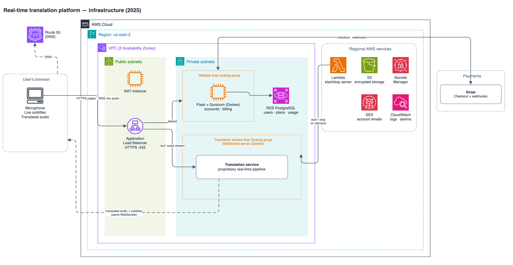

# Real-Time English ↔ Spanish Translation Platform

> **Role:** Cloud & DevOps Engineer – AI Prodigy  
> **Mission:** Deliver natural-sounding voice translation in the browser with ∼15 s latency.

This repo gives a **code-free, recruiter-friendly walkthrough** of the infrastructure I helped build.  
The translation pipeline is AI Prodigy's proprietary technology, so its design, models, source code, and endpoints remain private.

---

## 1 · What the Product Does

- **Live speech → subtitles → translated speech** in the browser, ~15 s end-to-end  
- Push-to-talk microphone, live subtitles, and translated audio playback  
- Role-based memberships (Free, Pro, Enterprise) control usage quotas

---

## 2 · High-Level Architecture

| Tier | Key Services | Notes |
|------|--------------|-------|
| **Frontend** | Flask/Jinja2 web app (HTML, CSS, JavaScript), secure WebSocket | No browser plug-ins required |
| **Translation service** | Dockerized WebSocket service on EC2 Auto Scaling | Proprietary pipeline (details private) |
| **Auth & Billing** | Stripe Checkout + Webhooks | Usage metering in Postgres |
| **Data Layer** | Amazon RDS Postgres, S3 | Encrypted at rest |
| **Infra / Ops** | EC2 Auto Scaling (2 AZ) behind HTTPS ALB | Rolling updates with health probes |

 

---

## 3 · My Contributions (Team Project)

| Phase | What I did |
|-------|------------|
| **System Design** | Contributed to latency-budget mapping and service selection during design reviews |
| **Data Pipeline** | Collected & transformed ~300 h bilingual audio–text pairs used for model evaluation |
| **Cloud Build** | Containerised the services and built the AWS environment (security groups, ASG, ALB, RDS, S3), later codified in Terraform |
| **Cost-Ops** | Replaced the NAT Gateway with a NAT instance + VPC interface endpoints → **~40 % monthly networking savings** |
| **Security** | Secrets Manager for all keys, TLS 1.3, WAF rate-limiting, HIPAA-aligned data path |

---

## 4 · Impact

- **98 % transcription accuracy** across 12 Spanish dialects  
- **15 s median latency** browser-to-browser (measured with client RUM)  
- **99.9 % availability** over last 90 days (ALB + multi-AZ ASG)

---

## 5 · Why It Matters

Need **reliable, low-latency AI workloads** in AWS—backed by measurable cost, security, and uptime guarantees?  
I deliver the full lifecycle:

> _design → data → cloud build → release engineering → monitoring → optimisation_

Let’s talk!
